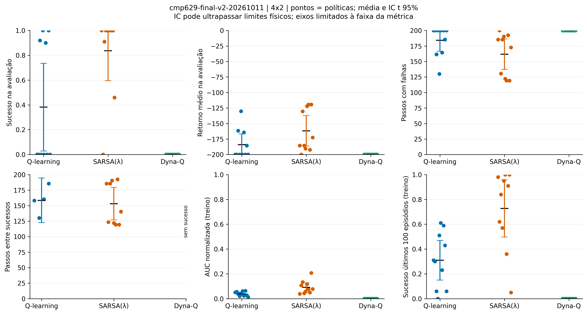
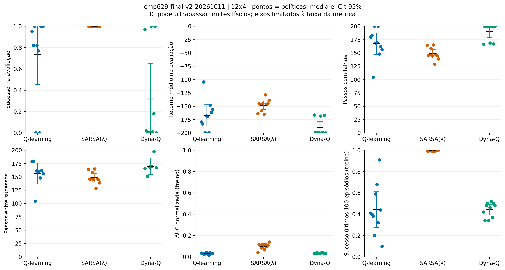

# Reinforcement Learning — projetos e experimentos

Repositório de projetos práticos de **Aprendizado por Reforço (Reinforcement Learning)**, com implementação em Python, experimentação reprodutível e materiais de apresentação.

Este repositório inclui o mini-projeto da disciplina **CMP629**, com comparação entre algoritmos tabulares no `MountainCar-v0`, e um estudo independente de controle Monte Carlo em GridWorld.

## Projetos disponíveis

| Projeto | Conteúdo | Acessar |
|---|---|---|
| **CMP629 · MountainCar-v0** | Q-learning, SARSA(λ) e Dyna-Q; experimentos, estatísticas, checkpoints e animações | [Abrir mini-projeto](mountaincar-tabular/README.md) |
| **Monte Carlo · GridWorld** | Notebook e estudo de métodos Monte Carlo | [Abrir projeto](monte-carlo-gridworld/README.md) |

> **Escopo:** mini-projeto MountainCar e seminário acadêmico são atividades diferentes. Nenhum trabalho de seminário ou projeto final ainda não documentado é apresentado aqui como concluído.

---

## CMP629 — comparação de algoritmos tabulares no MountainCar

O agente precisa acumular energia para conduzir um carro até a meta em um vale. Foram comparados três algoritmos de RL — **Q-learning**, **SARSA(λ)** e **Dyna-Q** — usando discretizações **4×2** e **12×4** das observações de posição e velocidade.

**Protocolo concluído:** 108 execuções de triagem preservadas; **60 treinamentos finais** (3 algoritmos × 2 discretizações × 10 seeds), com **100 avaliações greedy por política**, sem exploração, e métricas por seed. Os 60 checkpoints e os 120 CSVs brutos foram validados.

### Comece por aqui

| Quero... | Link |
|---|---|
| **Apresentar aos colegas** | [Notebook Google Colab](https://colab.research.google.com/github/antoniomoraes85/reinforcement-learning-projects/blob/main/mountaincar-tabular/notebooks/MountainCar_CMP629_Colab.ipynb) |
| **Assistir aos agentes** | [Comparação 12×4](mountaincar-tabular/figuras/animacoes_final_v2/comparacao_12x4.mp4) · [Comparação 4×2](mountaincar-tabular/figuras/animacoes_final_v2/comparacao_4x2.mp4) |
| **Entender a pesquisa** | [Relatório acadêmico](mountaincar-tabular/relatorios/final_v2/RELATORIO_TECNICO.md) · [Metodologia](mountaincar-tabular/docs/METODOLOGIA_FINAL.md) |
| **Conferir os resultados** | [Tabela completa](mountaincar-tabular/relatorios/final_v2/RESULTADOS.md) · [Estatísticas entre seeds](mountaincar-tabular/relatorios/final_v2/estatisticas_entre_seeds.csv) |
| **Inspecionar os gráficos** | [Figuras finais PNG, PDF e SVG](mountaincar-tabular/figuras/final_v2) |
| **Reproduzir os resultados** | [Código, protocolo e instruções](mountaincar-tabular/README.md) · [Dados e checkpoints originais (ZIP)](mountaincar-tabular/dados/auditoria_v2/final_v2_bundles.zip) |
| **Preparar a apresentação** | [Roteiro para o grupo](mountaincar-tabular/docs/ROTEIRO_APRESENTACAO.md) |

**Google Colab:** o notebook apresenta os dados e vídeos publicados sem retreinamento por padrão. Foi validado com kernel Python local limpo e downloads públicos; a execução no ambiente hospedado do Colab ainda requer confirmação manual.

### Resultados da campanha final

Taxa média de sucesso em **100 episódios de avaliação por política**, agregada entre **10 seeds de treinamento** por célula:

| Algoritmo | 4×2 | 12×4 |
|---|---:|---:|
| **SARSA(λ)** | **83,7%** | **100,0%** |
| Q-learning | 38,2% | 73,6% |
| Dyna-Q | 0,0% | 31,8% |

SARSA(λ) obteve a maior média observada em ambas as grades **neste protocolo experimental**. Esse resultado não implica superioridade universal. A variabilidade entre seeds é importante; por exemplo, o desvio-padrão de Dyna-Q 12×4 foi de **46,70 pontos percentuais**.

<table>
  <tr><th>Discretização 4×2</th><th>Discretização 12×4</th></tr>
  <tr>
    <td></td>
    <td></td>
  </tr>
</table>

### Demonstrações visuais reais

As animações são produzidas a partir de **Q-tables salvas e verificadas**, sem simular artificialmente resultados históricos. Cada vídeo informa algoritmo, discretização, seed, ações e evolução da trajetória.

A comparação apresenta políticas da **seed de treinamento 3100**, sob **o mesmo reset de avaliação 900000**. Essa trajetória única é ilustrativa e não substitui a análise das dez seeds.

- [Assistir à comparação 12×4 (MP4)](mountaincar-tabular/figuras/animacoes_final_v2/comparacao_12x4.mp4)
- [Assistir à comparação 4×2 (MP4)](mountaincar-tabular/figuras/animacoes_final_v2/comparacao_4x2.mp4)

### Reprodutibilidade e integridade

- Ambiente: **Gymnasium MountainCar-v0**, 3 ações e até 200 passos/episódio.
- Treinamento: 1.000 episódios por política, **γ = 0,99**.
- Avaliação: 100 seeds comuns por política, com escolha greedy e sem exploração.
- Hiperparâmetros globais selecionados **na triagem**, antes da campanha final.
- [Protocolo congelado](mountaincar-tabular/configs/protocolo_final_v2.json) · [Validação das 60 execuções](mountaincar-tabular/relatorios/final_v2/validacao_final.json) · [Manifesto SHA-256](mountaincar-tabular/dados/auditoria_v2/manifesto_publicacao.json)
- Resultados de treino exploratório e avaliação são reportados separadamente; interações reais, atualizações TD, planejamento Dyna-Q e componentes de traços SARSA(λ) têm unidades distintas.

Os dados são evidência específica deste benchmark. A possível influência do *state aliasing* é uma hipótese, não uma causa demonstrada. O projeto constitui uma referência experimental para futuras comparações de custo computacional em controle, **não uma comparação direta de MPC e RL**.

---

## Estrutura do repositório

```text
reinforcement-learning-projects/
├── mountaincar-tabular/
│   ├── src/mountaincar_rl/      # agentes, métricas e persistência
│   ├── configs/                 # protocolos congelados
│   ├── scripts/                 # execução, análise, figuras e validação
│   ├── testes/                  # testes automatizados
│   ├── dados/                   # triagem e bundles finais
│   ├── figuras/                 # gráficos e animações
│   ├── notebooks/               # Google Colab para apresentação
│   ├── relatorios/              # resultados e auditorias
│   └── docs/                    # metodologia e roteiro
└── monte-carlo-gridworld/       # notebook Monte Carlo
```

**Situação do projeto MountainCar:** experimentos finais concluídos e artefatos publicados; validação local documentada. Para detalhes técnicos, consulte o [README específico do mini-projeto](mountaincar-tabular/README.md).
